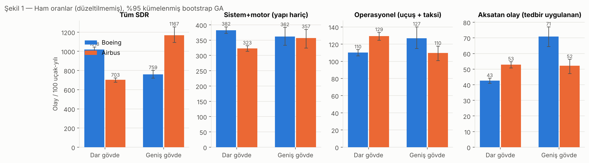
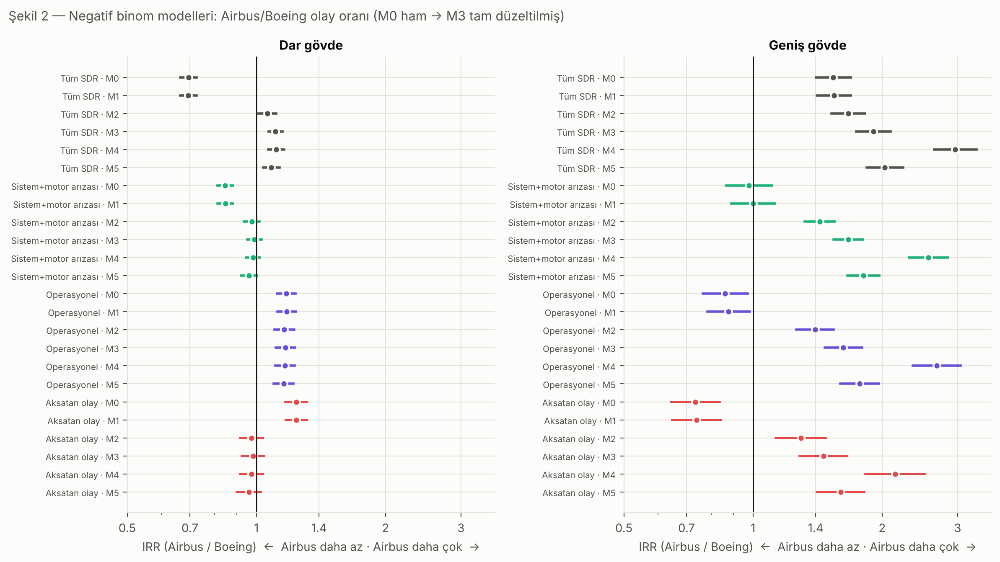
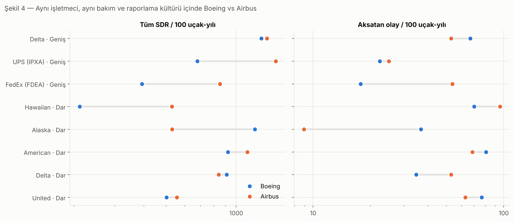
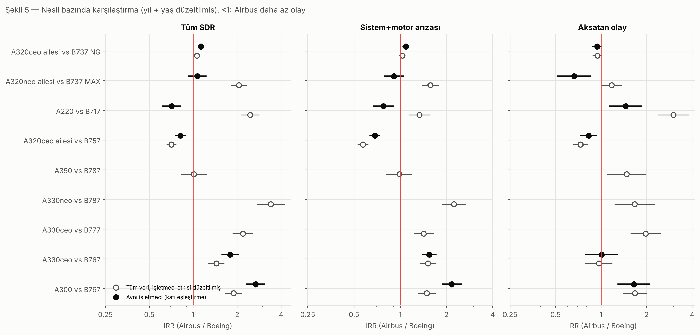
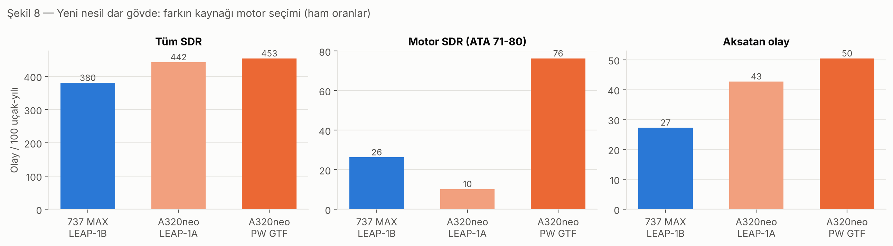
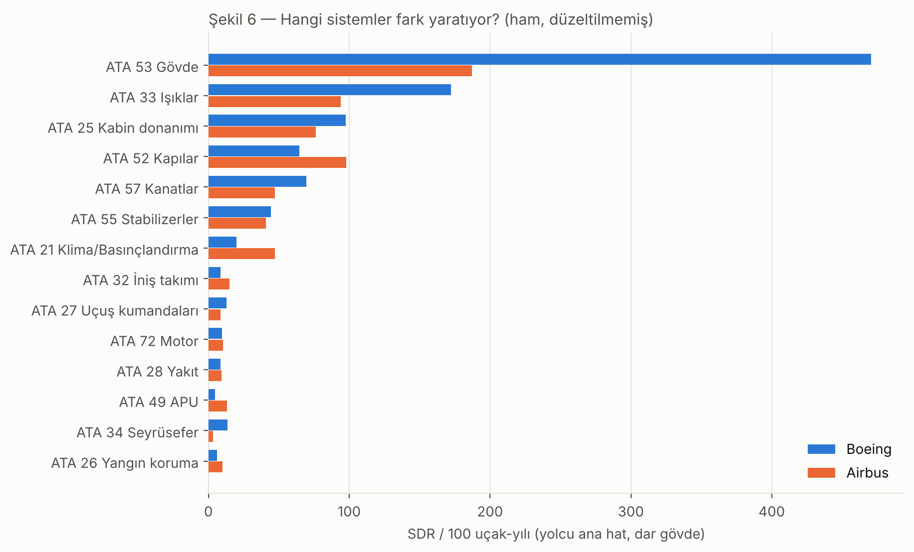
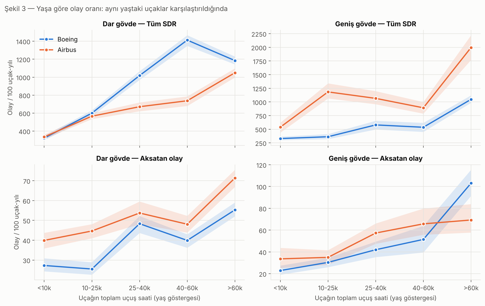
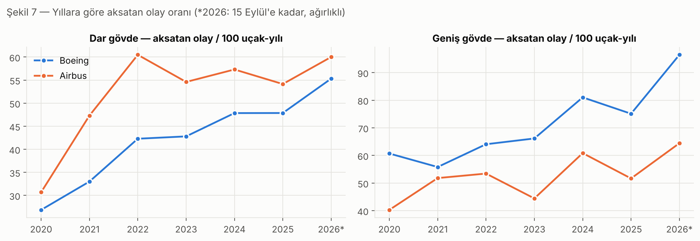

# Boeing mi, Airbus mu? FAA Servis Güçlüğü Raporlarıyla (2020-2026) Dar ve Geniş Gövde Arıza Riskinin Karşılaştırılması

**Veri:** FAA Service Difficulty Reporting System (SDRS), 01.01.2020 – 15.09.2026
**Kapsam:** ABD'de tescilli Boeing ve Airbus jetleri, 306.764 rapor, 7.253 uçak, 34.679 uçak-yılı
**Kod ve tekrar üretilebilirlik:** `src/`, `run_all.sh`; tüm adımlar için `INSTRUCTION.md`

---

## Özet

Bu çalışmada bir havayolunun sorusuna veriyle cevap aradık: *Dar gövde veya geniş gövde
uçak alınacak ya da kiralanacaksa, Boeing mi Airbus mu daha az arıza çıkarır?*
Kaynak olarak FAA'nın Servis Güçlüğü Raporlarını (SDR) kullandık. Ancak SDR yalnızca olayları
kaydeder, filo büyüklüğü vermez. Bu yüzden her uçağın filoda bulunduğu yılları, uçuş saatini
ve iniş sayısını aynı uçağın raporlarındaki toplam saat/döngü değerlerinden kendimiz türettik.
Böylece "olay / 100 uçak-yılı" oranları elde ettik. Arızayı dört katmanda ölçtük: tüm raporlar,
yapısal bulgular hariç sistem+motor arızaları, uçuşta/taksiyle ortaya çıkan operasyonel arızalar
ve plansız iniş, kalkış iptali ya da motor kapatma gibi tedbir gerektiren **aksatan olaylar**.
Analizde negatif binom regresyonu kullandık; yıl, işletmeci ve uçak yaşı etkilerini düzelttik.
Sonuçları aynı işletmeci içi karşılaştırmalar ve sekiz duyarlılık analiziyle sınadık.

**Ana bulgular:**

1. **Ham sayılar yanıltıcı.** Ham veride dar gövdede Boeing %45 daha fazla SDR üretiyor, aksatan
   olayda ise Airbus %24 daha kötü görünüyor. İki tablonun da asıl sebebi işletmeci farkı.
   Southwest tek başına Boeing dar gövde SDR'lerinin %47'sini oluşturuyor, ama önleyici tedbir
   kodunu neredeyse hiç kullanmıyor. Aynı tip uçakta bile işletmeciler arasında raporlama
   yoğunluğu 3,5 kat değişebiliyor.
2. **Dar gövde: üreticiler arasında sistematik fark yok.** Düzeltilmiş modelde Airbus/Boeing
   aksatan olay oranı **0,98 (%95 GA 0,92-1,04)**, sistem+motor arızası oranı **0,99 (0,95-1,03)**.
   Bu sonuç sekiz duyarlılık analizinin hepsinde değişmedi. Farkı yaratan şey üretici değil;
   **alt tip, motor ve işletmeci**.
3. **Yeni nesil dar gövdede belirleyici olan motor.** 100 uçak-yılı başına motor raporu
   A320neo+LEAP-1A'da **10**, 737 MAX'te (LEAP-1B) **26**, A320neo+PW1100G GTF'de **76**.
   Aynı işletmeciler içinde (American, United, Alaska) A320neo, 737 MAX'ten daha az aksatan olay
   üretiyor: IRR **0,66 (0,52-0,85)**. Sıralama: LEAP-1A'lı A320neo ≥ 737 MAX > GTF'li A320neo.
4. **Mevcut nesil (ikinci el / kiralık):** 737 NG ve A320ceo pratikte eşdeğer. A320ceo %6 daha az
   aksatan olay gösteriyor (0,94; 0,88-1,01, sınırda anlamlı), 737 NG ise %9 daha az sistem
   arızası (A320ceo/NG 1,09; 1,05-1,13). 757, A321ceo dahil A320ceo ailesinden belirgin biçimde
   daha kötü (aksatan olay 0,83; 0,74-0,93).
5. **Geniş gövde: Boeing hafif avantajlı, ama kanıt daha zayıf.** Airbus geniş gövdeler daha fazla
   sistem+motor arızası raporluyor. Bu sonuç tüm modellerde tutarlı: Delta içinde 1,58
   (1,42-1,75), yolcu filolarında 1,52 (1,38-1,67). Yolcu operasyonunda **aksatan olayda ise fark
   yok** (Delta içi 1,01; 0,79-1,28). 787 ve A350 sistem arızasında eşit (0,99; 0,82-1,19).

**Karar özeti:** Dar gövdede seçim "Boeing mi Airbus mu" diye değil, **motor ve alt tip**
üzerinden yapılmalı. Arıza riski açısından en iyi seçenek LEAP-1A motorlu A320neo; 737 MAX ona
yakın. GTF'li A320neo için motor arızası riski fiyata ve kira şartlarına yansıtılmalı.
Geniş gövdede veri Boeing'i (787/777) hafifçe öne çıkarıyor, ancak güven düzeyi orta-düşük.

---

## 1. Giriş

Uçak tedariki bir havayolunun en büyük sermaye kararıdır. Satın alma ya da 8-12 yıllık bir
operasyonel kiralama, filonun teknik güvenilirliğini on yıl boyunca belirler. Güvenilirliği
ölçmek için üreticilerin yayımladığı "dispatch reliability" (sefer güvenilirliği) değerleri
genellikle %99'un üzerindedir. Ancak bu değerler bağımsız değildir ve tipler arasında
karşılaştırılabilir biçimde yayımlanmaz.

ABD'de 14 CFR 121.703 ve 135.415 maddeleri, ticari işletmecilerin belirli arıza ve kusurları
FAA'ya bildirmesini zorunlu tutar. Bu raporlar FAA'nın **Servis Güçlüğü Raporlama Sistemi'nde
(SDRS)** toplanır ve kamuya açıktır. SDR verisi, üreticiden bağımsız ve aynı kurallarla
toplanmış nadir bir arıza kaynağıdır. Bu yüzden Boeing-Airbus karşılaştırması için doğal bir adaydır.

Bu makale şu soruyu yanıtlar: **Dar gövde ve geniş gövde sınıflarında hangi üreticinin uçakları
daha az arıza çıkarır, ve bu bulgular bir satın alma/kiralama kararını nasıl etkilemeli?**

## 2. Veri

### 2.1 Kaynak ve kapsam
Yedi yıllık SDR dışa aktarımı kullanıldı (2020-2025 tam yıl, 2026 ise 15 Eylül'e kadar).
Toplam 417.528 kayıt ve 77 sütun var. Bunlardan 307.607'si Boeing ya da Airbus kaydı. Temizlik
(tarih, tescil no, model eşleme) sonrasında **306.764 rapor** analize girdi (Tablo 1).

**Tablo 1 — Analiz örneği (gövde × üretici)**

| Gövde | Üretici | Uçak | Uçak-yılı | Uçuş saati (mn) | SDR | Aksatan olay | Medyan toplam saat |
|---|---|---:|---:|---:|---:|---:|---:|
| Dar | Boeing | 3.395 | 16.572 | 44,7 | 168.775 | 7.055 | 42.854 |
| Dar | Airbus | 2.227 | 10.461 | 30,1 | 73.509 | 5.528 | 33.358 |
| Geniş | Boeing | 1.316 | 6.060 | 18,6 | 45.977 | 4.295 | 64.727 |
| Geniş | Airbus | 315 | 1.586 | 4,5 | 18.503 | 827 | 30.824 |

Tablodaki tiplerin dağılımı şöyle:
- **Dar gövde Boeing:** 737 NG (1.985 uçak), 737 MAX (791), 757 (429), 717 (104), 737 Classic (86).
- **Dar gövde Airbus:** A320ceo ailesi (1.514), A320neo ailesi (546), A220 (167).
- **Geniş gövde Boeing:** 767 (642), 777 (290), 787 (218), 747 (166).
- **Geniş gövde Airbus:** A330ceo (119), A300 (118), A330neo (39), A350 (39).

### 2.2 SDR'nin doğası: çoğu rapor "uçuşta arıza" değil
Boeing/Airbus raporlarının **%77'si bakım/muayene sırasında** bulunan kusurlardır (korozyon,
çatlak, hasar). Uçuşu fiilen aksatan olayların payı yalnızca **%5,8**. Bu yüzden "SDR sayısı"
ile "arıza riski" aynı şey değil. Bu ayrım çalışmanın merkezinde yer alıyor (Bölüm 3.2).

### 2.3 Veri sorunları ve çözümleri
- **Belirsiz model kodları:** 13.666 kayıtta model alanı `737*`, `A320*` gibi genel bir değer içeriyor.
  Bu kayıtlara, aynı tescil numaralı uçağın diğer kayıtlarındaki baskın model atandı; 13.475'i
  bu şekilde dolduruldu.
- **737 MAX / NG karışıklığı:** Bazı işletmeciler NG uçakları için de müşteri kodsuz `7378`/`7379`
  yazıyor. Toplam uçuş saati MAX için fiziksel olarak imkânsız olan 1.370 kayıt NG'ye çevrildi.
  Bu kayıtlar arasında, hiç MAX işletmemiş olan Delta'nın yeni -900ER'leri de var.
- **Hatalı sayısal değerler:** 160.000 saati aşan toplam saat değerleri geçersiz sayıldı.

## 3. Yöntem

### 3.1 Payda: kuyruk-yıl paneli
Bir oran hesaplamak için paydaya ihtiyaç var. FAA tescil veritabanına bu çalışma ortamından
erişim yoktu, bu yüzden payda verinin kendisinden türetildi:

- **Filoda bulunma:** Her uçak, ilk ve son SDR yılı arasındaki her yıl filoda sayıldı. O yıl hiç
  rapor vermemiş olsa da sayıldı.
- **2026:** Kısmi yıl olduğu için 0,706 uçak-yılı ağırlığı aldı.
- **Kullanım:** Uçuş saati ve iniş sayısı, aynı uçağın farklı tarihli raporlarındaki toplam
  saat/döngü artışından dayanıklı eğimle (Theil-Sen tipi) tahmin edildi. Uçakların %85'inde
  doğrudan ölçüldü.
- **Yaş:** Takvim yaşı SDR'de bulunmadığı için yaş göstergesi olarak yıl ortasındaki tahmini
  toplam uçuş saati kullanıldı.

Türetilen filo büyüklükleri kamuya açık bilgilerle örtüşüyor: Southwest'in ~650 737NG'si,
American'ın ~400 A320 ailesi uçağı, Delta geniş gövdelerinin ~4.500 saat/yıllık kullanımı.

### 3.2 Arızanın dört katmanı

| Sonuç | Tanım | Yorum |
|---|---|---|
| Tüm SDR | Tüm raporlar | Bildirim yükü; bakım titizliğini de ölçer |
| Sistem+motor arızası | ATA 21-49 ve 71-80; yapı (51-57) hariç | Yaşlanma bulgularından arındırılmış bileşen arızası |
| Operasyonel | Taksi, kalkış, seyir, iniş vb. safhada ortaya çıkan | Hizmetteyken çıkan arıza |
| **Aksatan olay** | Plansız iniş, kalkış iptali, motor kapatma, acil alçalma, bloka dönüş… | **Operasyonu fiilen bozan arıza** |

Karar için birincil ölçüler **aksatan olay** ve **sistem+motor arızasıdır**.

### 3.3 İstatistik model
Birim kuyruk-yıldır. Sayım verisi aşırı yayılımlı olduğundan **negatif binom regresyonu**
kullanıldı. Payda `log(uçak-yılı)` olarak offset'e girdi. Standart hatalar uçak düzeyinde
kümelendi. Model adım adım kuruldu:

- **M0:** sadece üretici
- **M1:** + yıl
- **M2:** + işletmeci sabit etkisi
- **M3 (ana model):** + yaş grubu
- **M4 / M5:** payda olarak uçuş saati / iniş sayısı

Rapor edilen büyüklük **IRR = Airbus oranı / Boeing oranı**. IRR < 1 ise Airbus daha az olay
üretiyor demektir. Belirsizlik %95 güven aralığı (GA) ile verildi.

### 3.4 Sağlamlık kontrolleri
- **Sekiz duyarlılık analizi:** Southwest hariç, yalnız yolcu, yalnız kargo, COVID sonrası,
  ortak yaş aralığı, iki üreticiyi de işleten işletmeciler, kullanımı doğrudan ölçülen uçaklar.
- **Katı eşleştirme:** Tip karşılaştırmaları yalnızca her iki tipi de işleten işletmeciler
  içinde tekrarlandı.
- **Tek işletmeci modelleri:** Delta, United ve American için ayrı modeller kuruldu.

## 4. Bulgular

### 4.1 Ham tablo ve neden yanıltıcı olduğu



Ham oranlar karışık bir resim çiziyor (Şekil 1):
- **Dar gövde:** Boeing 100 uçak-yılında 1.018 SDR üretirken Airbus 703 üretiyor. Aksatan olayda
  ise tablo tersine dönüyor: Airbus 52,8, Boeing 42,6. Tam yıllarda bir dar gövde Airbus'ın en az
  bir aksatan olay yaşama olasılığı %33, Boeing'in %26.
- **Geniş gövde:** Airbus daha çok SDR üretiyor (1.167'ye 759), Boeing ise daha çok aksatan olay
  (70,9'a 52,2).

Bu farkların büyük kısmı üreticiden değil, **kimin uçurduğundan** kaynaklanıyor
(`09_isletmeci_raporlama_kulturu.csv`):

- Aynı 737 NG için **Southwest yılda uçak başına 18,7 SDR**, **United 5,4 SDR** raporluyor.
- Southwest, Boeing dar gövde SDR'lerinin **%47'sini** üretiyor. Buna karşın önleyici tedbir
  kodunu nadiren giriyor: aksatan olay oranı 100 uçak-yılında 6-12, diğer büyük işletmecilerde 25-80.
- Boeing geniş gövde filosu çok daha yaşlı (medyan 64.700 saat; Airbus'ta 30.800) ve büyük ölçüde kargo.

Şekil 2 bu etkiyi açıkça gösteriyor. Dar gövdede aksatan olay IRR'si M0'da 1,24 (Airbus kötü)
iken, işletmeci etkisi eklenince (M2) **0,97'ye** düşüyor. Geniş gövdede ise 0,73'ten (Airbus iyi)
1,29'a çıkıyor. Yani yönü bile işletmeci düzeltmesiyle değişiyor.



### 4.2 Dar gövde

**Tablo 2 — Dar gövde, ana model (M3: yıl + işletmeci + yaş). IRR = Airbus / Boeing**

| Sonuç | IRR | %95 GA |
|---|---:|---|
| Tüm SDR | 1,11 | 1,07 – 1,15 |
| Sistem+motor arızası | **0,99** | 0,95 – 1,03 |
| Operasyonel | 1,17 | 1,11 – 1,23 |
| Aksatan olay | **0,98** | 0,92 – 1,04 |

Düzeltilmiş modelde Airbus dar gövdeler %11 daha fazla toplam SDR ve %17 daha fazla operasyonel
rapor üretiyor. Ama **aksatan olay ve sistem+motor arızasında iki üretici istatistiksel olarak
ayırt edilemiyor**. Duyarlılık analizlerinde aksatan olay IRR'si 0,97 ile 1,03, sistem+motor
IRR'si 0,98 ile 1,09 arasında kaldı (`06_duyarlilik.csv`).

**Aynı işletmeci içinde** sonuç işletmeciye göre değişiyor (Şekil 4, `08b`). Yıl ve yaş
düzeltmeli aksatan olay IRR'leri:

| İşletmeci | IRR (Airbus/Boeing) | %95 GA | Daha az olay |
|---|---:|---|---|
| United | 0,68 | 0,61-0,75 | Airbus |
| American | 0,84 | 0,75-0,93 | Airbus |
| Delta | 1,78 | 1,60-1,98 | Boeing |

Delta'nın Airbus filosunda GTF motorlu A220 ve A321neo'lar, Boeing filosunda ise görece genç
737-900ER'ler bulunuyor. İşaretin işletmeciye göre değişmesi şunu gösteriyor: belirleyici olan
üretici markası değil, **filodaki belirli tip ve motor kombinasyonu**.



#### Nesil karşılaştırmaları



**Tablo 3 — Dar gövde tip eşleştirmeleri (katı eşleştirme: yalnız iki tipi de işleten şirketler, yıl+yaş düzeltmeli)**

| Karşılaştırma | İşletmeciler | Tüm SDR | Sistem+motor | Aksatan olay |
|---|---|---|---|---|
| A320ceo / 737 NG | AA, AS, UA, DL | 1,13 (1,08-1,17) | 1,09 (1,05-1,13) | **0,94 (0,88-1,01)** |
| A320neo / 737 MAX | AA, AS, UA | 1,07 (0,93-1,22) | 0,91 (0,79-1,04) | **0,66 (0,52-0,85)** |
| A320ceo / 757 | AA, UA, DL | 0,82 (0,76-0,88) | 0,68 (0,64-0,73) | 0,83 (0,74-0,93) |
| A220 / 717 | DL (yaş düzeltmesi yapılamadı) | 0,71 (0,62-0,82) | 0,78 (0,67-0,90) | 1,45 (1,14-1,85) |

- **Mevcut nesil (737 NG ↔ A320ceo):** Pratikte eşdeğer. A320ceo biraz daha az aksatan olay
  (‑%6, sınırda), 737 NG biraz daha az sistem arızası (‑%8) gösteriyor. İkinci el piyasasında
  bu fark, uçağın kendi bakım geçmişinin yanında ihmal edilebilir düzeyde.
- **757:** Aynı işletmecilerde A321ceo dahil A320ceo ailesine göre belirgin biçimde daha fazla
  arıza ve aksatan olay üretiyor. Üretimi biten ve yaşlı (medyan ~71.000 saat) bir tip için
  bu beklenen bir sonuç.
- **A220 ↔ 717:** A220 daha az rapor üretiyor ama daha çok aksatan olay yaşıyor (1,45). Bu, yeni
  bir tipin ilk yıllarındaki sorunlarıyla ve PW1500G GTF motoruyla uyumlu. 717'ler çok yaşlı
  olduğu için yaş düzeltmesi yapılamadı.

#### Yeni nesil: 737 MAX ↔ A320neo, ve motorun belirleyici rolü
Bu karşılaştırma bugün yeni uçak alacak ya da kiralayacak biri için en kritik olanı. Sonuç
kullanılan yönteme duyarlı çıktı:

- **Tüm veri modeli** (işletmeci etkisi diğer filolardan köprülenerek): A320neo, MAX'e göre daha
  kötü görünüyor. Aksatan olay 1,18 (1,01-1,37), sistem+motor 1,57.
- **Katı eşleştirme** (aynı şirkette hem MAX hem neo işleten American, United, Alaska): A320neo
  daha iyi. Aksatan olay 0,66 (0,52-0,85).

Çelişkinin kaynağı motor (Şekil 8). A320neo iki farklı motorla uçuyor. Yalnızca neo işleten
Spirit, Frontier, JetBlue ve Delta'nın neo'ları ağırlıklı olarak **Pratt & Whitney PW1100G GTF**
motorlu. American'ın A321neo'ları ise **CFM LEAP-1A** motorlu.



**Tablo 4 — Yeni nesil dar gövde, motora göre**

| Grup | Uçak | Uçak-yılı | Tüm SDR /100 uy | Motor SDR /100 uy | Aksatan /100 uy | Yıllık P(≥1 aksatan) |
|---|---:|---:|---:|---:|---:|---:|
| 737 MAX (LEAP-1B) | 791 | 2.221 | 380 | 26 | 27,3 | %19 |
| A320neo + LEAP-1A | 193 | 747 | 442 | **10** | 42,7 | %27 |
| A320neo + PW1100G GTF | 353 | 950 | 453 | **76** | 50,4 | %35 |

İşletmeci, yıl ve yaş düzeltmeli modelde (referans 737 MAX) **LEAP-1A'lı A320neo** belirgin
biçimde daha iyi çıktı:
- sistem+motor arızası **0,72** (0,61-0,85)
- aksatan olay **0,68** (0,51-0,91)
- motor SDR'si **0,36** (0,20-0,64)

**GTF'li A320neo** ise sistem+motor arızasında MAX'ten kötü çıktı: **1,24** (1,05-1,47).

Ham veride GTF'nin motor rapor oranı LEAP-1A'nın 7,5 katı ve MAX'in 3 katı. Ancak bu fark
büyük ölçüde yalnızca GTF işleten şirketlerde gözleniyor. Aynı şirket içi kanıt, United'ın küçük
A321neo filosuyla sınırlı. Yine de bulgu, PW1100G'nin 2023'te duyurulan toz metal (powder metal)
kusuru kaynaklı kapsamlı muayene/geri çağırma programıyla uyumlu.

**Dar gövde sonucu:** Üretici markası arıza riskini belirlemiyor. Yeni alım/kiralamada sıralama
**A320neo (LEAP-1A) ≥ 737 MAX > A320neo (GTF)**.

### 4.3 Geniş gövde

**Tablo 5 — Geniş gövde, IRR = Airbus / Boeing**

| Analiz | Tüm SDR | Sistem+motor | Aksatan olay |
|---|---|---|---|
| Ana model (M3, tüm veri) | 1,91 (1,74-2,09) | 1,67 (1,54-1,81) | 1,46 (1,29-1,66) |
| Yalnız yolcu | 1,56 (1,38-1,77) | 1,52 (1,38-1,67) | **1,10 (0,92-1,32)** |
| Yalnız kargo | 2,30 (2,03-2,61) | 1,79 (1,58-2,03) | 1,86 (1,55-2,25) |
| Delta içi (yıl+yaş) | 1,72 (1,49-1,98) | 1,58 (1,42-1,75) | **1,01 (0,79-1,28)** |

- **Sistem+motor arızasında** Airbus geniş gövdeler her analizde Boeing'den %50-80 daha fazla
  rapor üretiyor. Bu, geniş gövde tarafındaki en tutarlı bulgu.
- **Aksatan olayda** tablo karışık. Tüm veride Airbus %46 daha kötü görünüyor, ama bu sonucu
  büyük ölçüde kargo filoları sürüklüyor. FedEx ve UPS'te 30 yaşın üzerindeki A300-600F'ler
  yeni 767-300F'lerle kıyaslanıyor. Toplam saat, düşük kullanımlı A300'lerin takvim yaşını
  olduğundan genç gösteriyor (Bölüm 6). **Yolcu operasyonunda ve Delta içinde aksatan olay farkı yok.**
- **ATA dağılımı** (`10_ata_bolum_100ky.csv`): Yolcu geniş gövde filolarında Airbus'ın yüksek SDR
  yükünün büyük bölümü gövde yapısı (ATA 53: 100 uçak-yılında 422'ye 127), kapılar (ATA 52: 195'e 86)
  ve oksijen (ATA 35: 44'e 2) kaynaklı. Bu bölümlerin çoğu Delta'nın A330 filosundan geliyor. Aksatan
  olaylarda sistemler arası fark küçük.

**Tip eşleştirmeleri:**

| Karşılaştırma | Tüm SDR | Sistem+motor | Aksatan olay |
|---|---|---|---|
| A350 / 787 (köprü modeli) | 1,01 (0,83-1,24) | **0,99 (0,82-1,19)** | 1,47 (1,10-1,96) |
| A330neo / 787 | 3,40 | 2,24 | 1,66 (1,24-2,24) |
| A330ceo / 777 | 2,19 | 1,42 | 1,97 (1,57-2,47) |
| A330ceo / 767 (Delta içi) | 1,80 | 1,55 | **1,01 (0,79-1,28)** |
| A300 / 767 (FedEx+UPS içi) | 2,68 | 2,17 | 1,65 (1,30-2,08) |

- **787 ↔ A350:** Sistem+motor arızası eşit. Aksatan olayda Airbus aleyhine bir sinyal var (1,47),
  ama iki tip hiçbir işletmecide birlikte uçmuyor: A350 yalnızca Delta'da, 787 ise United ve
  American'da. Karşılaştırma işletmeci farkını başka filolar üzerinden "köprüleyerek" yapılıyor.
  Üstelik A350 örneği küçük (39 uçak, 162 uçak-yılı). Ham oranlarda A350'nin aksatan olay oranı
  41,3, 787'ninki 49,0 / 100 uçak-yılı. **Sonuç: eşit kabul edilmeli, güven düşük.**
- **777 ↔ A330ceo:** 777 her ölçüde daha iyi, ama bu da köprü modeline dayanıyor.

**Geniş gövde sonucu:** Veri, Boeing'i (özellikle 787 ve 777) **hafifçe** öne çıkarıyor.
En sağlam bulgu sistem+motor arıza raporlarında. Yolcu operasyonunu aksatan olaylarda ise
anlamlı bir fark yok.

Şekil 6 aynı analizi yolcu dar gövde filoları için gösteriyor. Boeing'in fazlası ağırlıkla gövde
yapısı (ATA 53) ve ışıklar (ATA 33) bulgularında; Airbus'ın fazlası ise klima/basınçlandırma
(ATA 21), kapılar (ATA 52) ve iniş takımında (ATA 32).



### 4.4 Yaş ve zaman



Şekil 3, yaş arttıkça bütün olay türlerinin arttığını gösteriyor. Dar gövdede toplam SDR farkı,
Boeing'in 25-60 bin saat aralığındaki yoğun yapısal muayene bulgularından kaynaklanıyor. Bu
aralık Southwest 737NG'lerinin korozyon programlarına denk geliyor. Aynı yaştaki uçaklarda
aksatan olay eğrileri birbirine yakın. Şekil 7'de 2020'deki düşüş (COVID, uçakların park
edilmesi) ve sonrasındaki normalleşme görülüyor. Yıl sabit etkileri bu dalgalanmayı modelden arındırıyor.



## 5. Tartışma: satın alma / kiralama kararına çeviri

**Tablo 6 — Karar matrisi**

| Senaryo | Veriye göre daha az arıza | Güç | Not |
|---|---|---|---|
| Yeni dar gövde | **A320neo (LEAP-1A)**, ardından 737 MAX | Orta-yüksek | GTF'li neo'da motor arızası riski yüksek; kira/garanti şartına yansıtılmalı |
| Kiralık/ikinci el dar gövde | 737 NG ≈ A320ceo | Yüksek | Marka yerine tek tek uçağın bakım kaydı ve yaşı belirleyici |
| Uzun menzil dar gövde | A321ceo/neo > 757 | Yüksek | 757 yaşlı ve üretim dışı |
| 100-150 koltuk | Belirsiz (A220 daha az rapor, daha çok aksatan olay) | Düşük | A220 hâlâ olgunlaşıyor; GTF etkisi |
| Yeni geniş gövde | 787 ≈ A350 | Düşük | Aynı şirkette birlikte uçmuyorlar, örnek küçük |
| Eski nesil geniş gövde | 777 / 767 ≥ A330ceo | Orta | Fark sistem arızası raporunda; aksatan olayda yok |

Bu çalışmanın en önemli dersi şu: **"Hangi üretici?" sorusu yanlış soru.** Dar gövdede
üretici etkisi sıfıra çok yakın. Buna karşılık işletmeci (raporlama ve bakım kültürü), motor
seçimi ve uçak yaşı, olay oranlarını kat kat değiştirebiliyor. Bu yüzden satın alma/kiralama
müzakeresinde şunlara odaklanmak gerekiyor:

1. **Motor seçimi ve motor garantisi.** Özellikle GTF'de motor bakım rezervleri, yedek motor
   erişimi ve garanti koşulları.
2. **Uçağın bireysel geçmişi.** Kiralamada SDR geçmişi, tescil numarası üzerinden bu veriyle
   doğrudan sorgulanabilir.
3. **Kendi bakım organizasyonunun yetkinliği.** Aynı uçak farklı işletmecide çok farklı sonuç verebiliyor.

SDR verisinin ölçmediği konular da kararda ağırlık taşımalı: 737 MAX'in 2019-2020'deki uçuş
yasağı ve sonraki üretim/kalite denetimleri, teslimat takvimleri, yakıt verimliliği, ikinci el
değeri ve pilot ortaklığı.

## 6. Sınırlılıklar

1. **SDR bir arıza sayımı değil, bir bildirim sistemidir.** Hangi olayın raporlanacağı
   işletmecinin yorumuna bağlı. İşletmeci sabit etkisi bu farkın düzeyini düzeltir, ama
   işletmecinin farklı tipleri farklı titizlikte raporlaması (tip×işletmeci etkileşimi)
   düzeltilemez.
2. **Payda veriden türetildi.** Hiç SDR vermemiş uçaklar paydaya girmedi. 2020 başında ve 2026
   sonunda filo eksik sayılmış olabilir (kesilme etkisi).
3. **Takvim yaşı yok.** Toplam uçuş saati, düşük kullanımlı kargo uçaklarının (A300, 757F)
   yaşını olduğundan genç gösterir. Geniş gövde kargo karşılaştırmaları bu yüzden temkinle okunmalı.
4. **Yalnız ABD.** Avrupa veya Asya'daki işletmeci, iklim ve bakım koşulları farklı olabilir.
5. **Önleyici tedbir kodlarının anlamı** metin örneklerinden doğrulandı. Resmî kod listesindeki
   küçük farklılıklar "diğer acil/anormal" grubunu etkileyebilir, ama ana kodlar (A, C, E) nettir.
6. **Gecikme ve iptal verisi yok.** Aksatan olay, sefer güvenilirliğinin vekil göstergesi. Gerçek
   maliyet için BTS gecikme verisi veya işletmecinin kendi güvenilirlik raporları gerekir.
7. **Bazı karşılaştırmalar az sayıda işletmeciye dayanıyor:** A350 yalnızca Delta'da,
   A220/717 yalnızca Delta'da, MAX/neo katı eşleştirmesi üç işletmecide.

## 7. Sonuç

FAA SDR verisiyle yapılan bu analiz, Boeing ve Airbus arasında **dar gövdede sistematik bir
arıza farkı bulunmadığını** gösteriyor. Aksatan olay IRR'si 0,98 (0,92-1,04), sistem+motor
arızası IRR'si 0,99 (0,95-1,03). Bugün yeni uçak alacak bir işletmeci için belirleyici olan
**motor**: LEAP-1A motorlu A320neo ve 737 MAX düşük, PW1100G GTF motorlu A320neo ise yüksek
motor arızası oranı gösteriyor. **Geniş gövdede** Boeing (787/777) sistem arızası raporlarında
hafif üstün, ama yolcu operasyonunu aksatan olaylarda iki üretici arasında anlamlı bir fark yok.

Kısacası: *Dar gövdede "Boeing mi, Airbus mu?" yerine "hangi motor, hangi uçak, kimin bakımında?"
diye sorun. Geniş gövdede veri Boeing'e hafifçe yatıyor, ama karar başka ölçütlerle birlikte verilmeli.*

---

### Ek A — Tekrar üretme
```bash
pip install -r requirements.txt
# data/raw/ içine SDR-2020.csv … SDR-2026.csv
bash run_all.sh
```
Tüm sayılar `results/tables/` altındaki CSV'lerden, şekiller `results/figures/` altından gelir.
Adımların ayrıntılı açıklaması `INSTRUCTION.md` dosyasındadır.

### Ek B — Terimler
- **SDR:** Service Difficulty Report (Servis Güçlüğü Raporu).
- **IRR:** Incidence Rate Ratio. İki grubun olay oranlarının oranı.
- **Uçak-yılı:** Bir uçağın filoda geçirdiği bir yıl.
- **ATA bölümü:** Uçak sistemlerinin standart numaralandırması (21 klima, 32 iniş takımı,
  53 gövde, 72 motor …).
- **ceo / neo:** current / new engine option (A320 ailesinin eski ve yeni motor seçenekleri).
- **GTF:** Pratt & Whitney Geared Turbofan (PW1100G / PW1500G).
- **LEAP:** CFM International'ın yeni nesil motoru (A320neo için LEAP-1A, 737 MAX için LEAP-1B).
